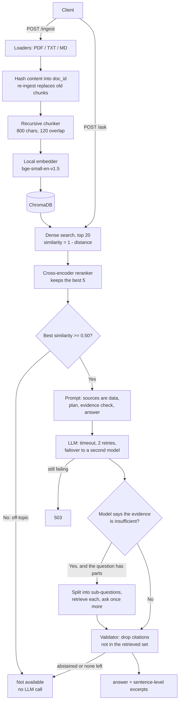

# Reliable RAG API

[](https://github.com/sanjith3057/-reliable-rag-api/actions/workflows/ci.yml)

A knowledge assistant that answers questions from your documents. It cites the passage each answer
came from, and when the documents do not contain the answer it says so instead of guessing.

- **Grounded:** every answer carries the document name, page and the exact sentences it relied on.
- **Abstains:** a retrieval gate and a citation validator stop unsupported answers before they reach you.
- **Measured:** 20 / 20 on a fictional test set and 18 / 18 on a real 88-page PDF, from live runs you can repeat with `POST /eval`. You can also measure it on your own documents: it writes the question set for you. The history of how it got there, including the runs that failed, is in the Evaluation section.
- **Tested:** 156 automated tests that run offline with a fake LLM, including failure cases.
- **Guarded:** admin and read-only API keys, per-client rate limits, request size caps and security headers.

## Requirements checklist

| Brief requirement | Where it is met |
| --- | --- |
| Ingest PDF, TXT, Markdown and split into chunks | `POST /ingest`, `app/ingestion/` (recursive chunker, 800 chars, 120 overlap) |
| Semantic search with embeddings and a vector store | `app/retrieval/` (`bge-small-en-v1.5`, ChromaDB, cosine similarity) |
| LLM answers grounded in retrieved content | `app/pipeline.py`, `app/generation/prompt.py` |
| Evidence: document names and excerpts | `sources[]` on every answer: document, page, sentence-level excerpt, score |
| Say clearly when the information is unavailable | Retrieval gate, model abstention and citation validator (`app/generation/validator.py`) |
| API in FastAPI | `app/api/routes.py`, interactive docs at `/docs` |
| At least 10 evaluation questions of three kinds | 20 test + 18 real-document + 21 dev questions in `eval/`: answerable, unanswerable, multi-evidence, plus distractors |
| Clean, modular Python | One package per stage; the LLM, embedder and reranker sit behind interfaces |
| Environment variables for keys and config | `app/config.py`, `.env.example` |
| Tests for retrieval, API behaviour, failure cases | `tests/` (156 tests), results in [`tests/RESULTS.md`](tests/RESULTS.md) |
| Docker support and setup documentation | `Dockerfile`, `docker-compose.yml`, Quick start below |
| Existing LLM API, no training from scratch | Groq, OpenAI or Gemini through one HTTP client; embeddings are a pretrained local model |
| Sample documents and evaluation questions | `sample_docs/` (8 fictional documents), `real_docs/` (one real PDF), `eval/questions_*.json` |
| Discussion of limitations | Limitations section below |

## Quick start

### Docker

```bash
cp .env.example .env        # add your GROQ_API_KEY (or set LLM_PROVIDER=fake to try it with no key)
docker compose up --build
```

Open http://localhost:8000 for the web console, or http://localhost:8000/docs for the interactive API
docs. Both models (embedder and reranker) are downloaded during the image build, so the container starts offline. The
vector store lives on a named Docker volume and survives restarts.

### Local

```bash
python -m venv .venv && source .venv/bin/activate    # Windows: .venv\Scripts\activate
pip install -r requirements-dev.txt
cp .env.example .env                                  # add your GROQ_API_KEY
uvicorn app.main:app --factory --reload
```

Requires Python 3.12 to 3.14. The first start downloads the embedding and reranker models (about 220 MB).

## Web console

The same server hosts a small UI at `/`: upload documents, ask questions, see the cited evidence with
its similarity score, and run the evaluation. It is plain HTML, CSS and JavaScript with no build step.

## API

| Method | Endpoint | Purpose |
| --- | --- | --- |
| POST | `/ingest` | Upload a PDF, TXT or MD file |
| POST | `/ingest/samples` | Ingest the bundled sample documents |
| POST | `/ask` | Question in, grounded answer and sources out |
| GET | `/documents` | List ingested documents |
| DELETE | `/documents/{doc_id}` | Remove one document |
| POST | `/reset` | Clear the store |
| GET | `/health` | Liveness and current configuration |
| POST | `/eval` | Run an evaluation set through the live pipeline, optionally with an LLM judge |
| POST | `/eval/generate` | Write an evaluation set from the documents in the library |
| GET | `/eval/latest` | The most recent evaluation report |

```bash
# Ingest
curl -F "file=@sample_docs/hr_policy_2025.md" http://localhost:8000/ingest

# Ask something the documents answer
curl -X POST http://localhost:8000/ask -H "Content-Type: application/json" \
  -d '{"question": "How many days of annual leave do employees get in 2025?"}'
```

```json
{
  "answer": "24 days",
  "answerable": true,
  "sources": [
    {
      "doc_name": "hr_policy_2025.md",
      "page": null,
      "excerpt": "In 2025, full-time employees are entitled to 24 days of paid annual leave per calendar year.",
      "score": 0.8213
    }
  ],
  "abstain_reason": null,
  "warnings": []
}
```

```bash
# Ask something they do not answer
curl -X POST http://localhost:8000/ask -H "Content-Type: application/json" \
  -d '{"question": "Who is the CEO of Lumenfold Systems?"}'
```

```json
{
  "answer": "The information is not available in the provided documents.",
  "answerable": false,
  "sources": [],
  "abstain_reason": "model_abstained",
  "warnings": []
}
```

`warnings` lists automatic checks the answer did not fully pass. Today there is one: a figure in the
answer that does not appear in the cited passages.

`abstain_reason` is `below_threshold` (nothing relevant was retrieved, no LLM call was made),
`model_abstained` (related passages were found but none state the answer) or `no_valid_citations`
(the model answered but could not tie the answer to a retrieved passage).

```bash
# Run the evaluation (no body = eval/questions_test.json)
curl -X POST http://localhost:8000/eval
```

Every error has one shape:

```json
{"error": {"code": "UNSUPPORTED_FILE_TYPE", "message": "Only PDF, TXT, MD are accepted", "request_id": "3f9c1a2b7d10"}}
```

Limits: 10 MB and 500 PDF pages per file, 1,000 characters per question, 50 questions per custom
evaluation, 256 KB per JSON request.

## Security

| Control | How |
| --- | --- |
| API keys | Set `API_KEY` and every data endpoint requires a matching `X-API-Key` header (401 otherwise). An optional `READ_API_KEY` can only ask questions and list documents; uploading, deleting, resetting and evaluating return 403 without the admin key. Comparison is constant-time. The UI shell, `/health` and `/docs` stay public. Both are empty by default, so local use needs no setup. |
| Rate limiting | Sliding window per client address, with a separate budget for each kind of work: 30 questions, 20 uploads and 3 evaluations per minute, 120 for everything else. Over the limit returns 429 with a `Retry-After` header, before any LLM call is made. `X-Forwarded-For` is ignored unless `TRUSTED_PROXY_HOPS` says how many proxies are yours, and then it is read from the right, so a caller cannot forge an address to dodge the limit. |
| Request size | 10 MB for uploads, 256 KB for JSON. A body is refused from its declared length before it is read, and the bytes are also counted as they arrive, so a streamed upload with no `Content-Length` is cut off at the limit too. PDFs are capped at 500 pages. |
| Upload handling | Only `.pdf`, `.txt`, `.md`. Filenames are reduced to a safe display name (no paths, no markup), because the name is stored, shown in the UI and written into the prompt. Files are parsed in memory and never written to disk or executed. |
| Prompt injection | Document text sits inside `<source>` blocks it cannot close or forge; the system prompt declares sources to be data. An answer that carries no valid citation is discarded, so an obedient model still cannot leak an injected reply. |
| Browser | `Content-Security-Policy` with no inline scripts or styles, `X-Frame-Options: DENY`, `X-Content-Type-Options: nosniff`. All document and model text is rendered with `textContent`. No CORS headers are sent, so other sites cannot call the API from a browser. |
| Secrets | Keys come from environment variables only, `.env` is git-ignored, and keys never appear in responses or logs. Unexpected errors return a generic 500; details go to the server log with the request ID. |
| Container | Runs as an unprivileged user. |

```bash
# With API_KEY set
curl -H "X-API-Key: $API_KEY" http://localhost:8000/documents
```

What this does not cover is listed under Limitations.

## How it works



```
app/
  main.py            app factory, request middleware
  config.py          every setting, overridable by env var
  errors.py          the one error schema
  security.py        API key, rate limiter, size caps, input sanitising
  pipeline.py        RagService: ingest and ask
  api/routes.py      HTTP endpoints
  ingestion/         loaders, recursive chunker, content hashing
  retrieval/         embedder, vector store, retriever, reranker, optional BM25
  generation/        LLM interface, providers and failover, prompt, validator, excerpts
  evaluation/        evaluator and metrics, shared by /eval and the CLI
  static/            web console
eval/                dev, test and real question sets, CLI, results
sample_docs/         8 fictional documents, including one prompt-injection document
real_docs/           one real 88-page PDF (the GDPR regulation)
tests/               156 tests and their recorded results
```

## Decisions and trade-offs

**Distance is converted to similarity in one place.** ChromaDB returns cosine *distance*, where
smaller is better. Comparing that against a "minimum similarity" threshold inverts the gate: the system
either refuses everything or answers everything. `vector_store.distance_to_similarity` does the
conversion once, and `tests/test_similarity.py` checks it against vectors with a known cosine.

**A loose retrieval gate before the LLM.** If the best passage scores below 0.50, the API returns "not
available" without calling the LLM. I first set this to 0.60, which looked safe on the sample documents
(their lowest answerable question scores 0.66). It was not: on a real document, valid questions scored
between 0.55 and 0.66 and were being refused. Cosine scores from this embedding model sit in a narrow
band, so a tight threshold tuned on one corpus does not transfer to another. At 0.50 the gate only
stops clearly off-topic questions ("Who won the World Cup?" scores 0.47). Near-topic traps pass it by
design and are handled by the model's own abstention and the validator.

**A reranker after dense search.** The 20 nearest chunks are re-scored by a small cross-encoder and
the best 5 are kept. This was off in my first version because it made no difference on the sample
documents. On a real markdown document with tables it was the difference between finding the right
passage for 6 of 10 questions and 10 of 10. On the published sets its gain is small (see the retrieval
evaluation), and it adds about 0.7 s per question on CPU, so this default is a judgement call.

**A validator after the LLM.** The model must return JSON with the source ids it used. Citations that
do not match a retrieved passage are dropped, as are citations to passages the model itself labelled a
distractor. An answer with no surviving citation is replaced by "not available". This is what makes a
hallucinated source impossible to return, whatever the model does.

**Fictional sample documents.** The sample corpus describes a made-up company. The model cannot know
these facts from training, so a correct answer proves retrieval worked, and a refusal on "What is the
capital of Australia?" proves the model is not answering from memory.

**A PrismRAG-inspired prompt, not PrismRAG.** The prompt asks for a plan, then a per-source evidence
check that flags distractors, then the answer. That shape is borrowed from the PrismRAG paper. The
paper's actual method is fine-tuning on distractor-heavy data, which this project does not do.
Grounding here is enforced in code after the model answers (the gate, the citation validator, the
number check), so it holds for any model behind the API and can be tested without one.

**Position-aware context.** The strongest passages go at the start and end of the context and the
weakest in the middle, because models attend least to the middle of a long prompt.

**Local embeddings.** `bge-small-en-v1.5` runs on CPU, costs nothing per call, and keeps document text
on the machine. Tests swap in a deterministic hash embedder so CI needs no model download.

**One HTTP client for three providers.** Groq, OpenAI and Gemini all accept the OpenAI chat-completions
format, so `OpenAICompatibleLLM` covers them with a different base URL and key. `LLM_PROVIDER` selects
one. `FakeLLM` implements the same interface for tests.

**Multi-part questions get a second pass.** Two triggers split a question into sub-questions and
retrieve each part separately. Before answering: when the best score is weak (between 0.50 and 0.60),
to a maximum depth of 2. After answering: when the model reports that the evidence is insufficient,
once. A question that asks for a single fact yields no sub-questions, so a genuine "not available"
costs one small extra call and stays a refusal. If the split fails, the pipeline carries on with the
evidence it already has.

**Failover between models.** Free tiers cap tokens per minute and per day for each model separately.
When the main model is rate limited, calls go to the next model in a chain until the limit resets
(`LLM_FALLBACK_MODEL`, three models by default on Groq). If the provider says the wait is longer than 30 seconds, the request fails
at once with `LLM_RATE_LIMITED` and a `Retry-After` header, because retrying cannot help. I found this
the hard way: my own evaluation runs used up a 200,000-token daily quota and the first version just
waited and returned a vague 503.

**A number check on every answer.** An invented figure is the most common and most damaging kind of
hallucination, and it is cheap to catch: every number in an answer must appear in a cited passage or
in the question. A miss is reported as a warning, not a refusal, because a correct answer can contain
a figure the model worked out, such as a difference between two values.

**Excerpts without another LLM call.** The cited chunk is split into sentences, and the sentences
closest to the question and answer are returned, ranked with the same embedder.

**Re-ingestion.** The document id is a hash of the file bytes, so uploading the same file twice
replaces its chunks. Uploading a different file under an existing name is treated as a new version and
replaces the old one.

**Prompt injection.** Document text is placed inside `<source>` blocks that the document cannot close
or forge, and the system prompt states that sources are data and never instructions.
`sample_docs/it_notice.txt` contains an "ignore all previous instructions" attack and is part of the
evaluation corpus.

**Lazy imports.** ChromaDB, pypdf, the BM25 library, the HTTP client and sentence-transformers are
imported inside the functions that first need them, not at module load. Importing the app dropped
from about 1.7 s to 0.8 s on my machine, which speeds up tests, the CLI and worker start-up, and
features that are switched off (BM25) never load their libraries at all. The models themselves are
still loaded at server start, on purpose, so the first question is not slow. Python 3.15 adds a
`lazy import` statement (PEP 810) that does this more cleanly, and I tried it: the statement works on
3.15, but `onnxruntime`, which ChromaDB requires, has no Python 3.15 wheels yet, so the project cannot
run there today. Function-level imports give the same effect on Python 3.12 to 3.14.

**A hand-written rate limiter.** About 30 lines with no dependency, which is enough for one process.
The trade-off is that each worker or replica keeps its own count; a multi-instance deployment would
move the counters to Redis.

**BM25 fusion is implemented but off.** `ENABLE_HYBRID` adds keyword search fused with dense search.
In the retrieval evaluation it never found evidence that dense search missed and it lowered Recall@5,
so it is not a default.

## Evaluation

Every number below comes from a live run: real retrieval, the real LLM, no mocks. All sets run against
one mixed corpus of 584 chunks: the 8 short fictional documents plus an 88-page real PDF (the GDPR
regulation, `real_docs/`).

| Set | Questions | Written against | Purpose |
| --- | --- | --- | --- |
| `questions_dev.json` | 21 | Both | Tuning only. Never reported as a result. |
| `questions_test.json` | 20 | Fictional documents | Grounding: the model cannot know these facts from training |
| `questions_real.json` | 18 | The GDPR PDF | Retrieval and abstention on long, dense, real text |

The test set has 6 single-fact questions, 4 multi-evidence, 5 unanswerable (two near-topic traps, one
general knowledge) and 5 distractor questions (2024 vs 2025 handbook, Orbit A1 vs B2, and a year and a
product that do not exist). The real set has 10 single-fact, 3 multi-part and 5 unanswerable questions,
such as "What does the Regulation say about blockchain?" and "What is the maximum fine under the
California Consumer Privacy Act?".

### Results

Configuration: Groq `openai/gpt-oss-20b` at low reasoning effort, `bge-small-en-v1.5`, reranker on,
top-k 5, gate 0.50. Run on 12 Oct 2026.

| Metric | Test set (fictional) | Real set (GDPR) | Definition |
| --- | --- | --- | --- |
| Questions passed | 20 / 20 | 18 / 18 | Every applicable check below passed |
| Retrieval hit@5 | 100% | 100% | The expected documents were retrieved and, on the real set, the supporting passage is inside a retrieved chunk |
| Abstention accuracy | 100% | 100% | Answered when it should, refused when it should |
| Citation correctness | 100% | 100% | At least one citation, and every citation is an expected document |
| Answer keyword accuracy | 100% | 100% | The answer contains the expected facts |
| Distractor resilience | 100% | n/a | Cited the right document and not the near-miss |
| Average latency | 5.6 s | 8.7 s | Dominated by rate-limit waits, see below |

Per-question tables: [`eval/results.md`](eval/results.md) and [`eval/results_real.md`](eval/results_real.md).

**One question is borderline.** r12 asks two things at once: how quickly a breach must be reported
and what the highest fine is. Those facts are on pages 52 and 83. In the run before this one it failed:
the two passages were not both retrieved, the model said the evidence was insufficient, and the system
refused. In this run the second pass found both and it passed, after 24 seconds. I count that as a
question the system can get right, not one it reliably does. Across every run, a failure was always a
wrong refusal or a provider error: no question in either set produced an unsupported answer.

### Evaluate on your own documents

The sets above only show how the system does on documents I chose. To measure it on yours, upload
them and pick "My documents" in the Evaluate tab, or call the API:

```bash
curl -X POST http://localhost:8000/eval/generate -H "Content-Type: application/json" -d '{"n": 8}' > set.json
curl -X POST http://localhost:8000/eval -H "Content-Type: application/json" \
  -d "{\"questions\": $(jq .questions set.json), \"judge\": true}"
```

`/eval/generate` samples passages from the library and has the LLM write one question per passage,
with the answer keyword and a supporting quote. A draft is kept only if that quote and keyword really
are in the passage, so the gold labels cannot be invented. Three general-knowledge questions are added
that a grounded system must refuse. With `"judge": true`, a second LLM call grades each answer for
faithfulness (every claim is supported by the cited passages) and relevance.

Result on a document the system was never tuned on, a 5-page design document for an IT service desk
(10 chunks, not published here):

| Metric | Value |
| --- | --- |
| Questions passed | 10 / 10 (7 generated, 3 general-knowledge traps) |
| Retrieval hit@5 | 100% |
| Abstention accuracy | 100% |
| Citation correctness | 100% |
| Answer keyword accuracy | 100% |
| Faithfulness (LLM-judged) | 100% |
| Answer relevance (LLM-judged) | 100% |

That run was answered by `qwen/qwen3.8-27b`, the third model in the failover chain, because the
other two had used up their daily quota. Limits of this number:

- **Generated questions are easier than human ones.** Each comes from a single passage and tends to
  reuse its wording, so it does not test multi-part questions or paraphrase.
- **The judge is not independent.** It is the same model that wrote the answer, so it shares its
  blind spots. Treat judged scores as a check for obvious unsupported claims, not as ground truth.
- **The first run of this feature scored 25% on answer accuracy with every answer correct.** The
  generated keywords were too literal ("four" when the answer said "4", or a whole sentence). I
  fixed the generator and the matcher, not the answers; the judged faithfulness was 100% both times.

### How these numbers changed, and why

I am including the history because the first version looked better than it was.

1. **First version: 20 / 20 on the test set.** Dense search only, gate at 0.60, tuned and tested only
   on the fictional documents.
2. **It then failed on a real document.** On a 28-chunk markdown file with tables, 3 of 4 ordinary
   questions were refused. Two causes: dense search did not rank the right passage in the top 5, and
   the gate blocked a valid question that scored 0.555.
3. **First run on the GDPR set: 11 / 18.** Six questions failed with `LLM_UNAVAILABLE` because the
   provider's rate limit outlasted the retries, and r12 failed as described above.
4. **Changes made in response:** reranker on, gate lowered to 0.50, second pass on abstention, model
   failover, fail-fast on long rate limits, and the evaluator now retries a rate-limited question
   after a pause so that a quota is not scored as a wrong answer. Each was checked on the dev set.
5. **Next run: 20 / 20 and 17 / 18**, with r12 still refused.
6. **One more change.** Testing failover on a real document showed the smaller model sometimes spent
   its output on hidden reasoning and returned no JSON. Setting its reasoning effort to low fixed that.
7. **Final run: 20 / 20 and 18 / 18.**

Steps 2 to 6 used information from outside the dev set, including the earlier real-set runs, so the
real-set score is not a clean held-out number. No change was made to target r12 specifically.

### Retrieval and fusion evaluation (no LLM)

Retrieval measured on its own, so a good or bad LLM cannot hide it. A chunk is relevant if it
contains the gold evidence text for the question. 584 chunks, 13 questions per set. Full output,
including nDCG@10, is in [`eval/retrieval_eval.md`](eval/retrieval_eval.md).

Real document (GDPR):

| Retrieval | Recall@3 | Recall@5 | Recall@10 | MRR | nDCG@5 | Mean latency | P95 |
| --- | --- | --- | --- | --- | --- | --- | --- |
| BM25 only | 0.54 | 0.54 | 0.54 | 0.49 | 0.48 | 2 ms | 3 ms |
| Dense only | 0.81 | 0.96 | 1.00 | 0.80 | 0.82 | 20 ms | 27 ms |
| Hybrid (BM25 + dense) | 0.81 | 0.81 | 0.96 | 0.79 | 0.76 | 23 ms | 29 ms |
| **Dense + reranker (default)** | 0.88 | 0.96 | 1.00 | 0.78 | 0.80 | 723 ms | 1199 ms |
| Hybrid + reranker | 0.88 | 0.96 | 0.96 | 0.78 | 0.80 | 2209 ms | 3659 ms |

On the fictional documents every method reaches Recall@5 of 1.00 and an MRR of 0.94 to 0.96, so that
set cannot tell them apart.

Complementarity, judged on full recall in the top 5: on the GDPR set both methods found the evidence
for 6 questions, only dense found it for 6, only BM25 for none, and neither for 1.

What this says:

- **Hybrid search is not worth it here.** BM25 never found evidence that dense search missed, and
  fusing it in pushed good dense results down (Recall@5 fell from 0.96 to 0.81). These questions are
  natural-language paraphrases, which is where keyword search is weakest. The sets contain no
  exact-token questions (error codes, IDs, function names), which is where BM25 should win, so this is
  a result about these questions, not about hybrid search in general.
- **The reranker's gain on these sets is small**: Recall@3 rises from 0.81 to 0.88, Recall@5 is
  unchanged, and MRR dips from 0.80 to 0.78. It costs about 0.7 s per question on CPU.
- **Why it is still on.** On a private markdown document with tables (10 questions, measured by hand)
  dense search put the evidence in the top 5 for 6 questions and the reranker for all 10, and on the
  dev set it took 12 of 13 to 13 of 13. That is weaker evidence than the table above, because I cannot
  publish that document. On the published sets alone, dense-only would be a defensible default and
  0.7 s faster; `ENABLE_RERANKER=false` gives that.

### Read these numbers with care

- **Small sets, written by me.** 59 questions in total. This shows the pipeline works as designed on
  two kinds of document; it is not a benchmark.
- **The model already knows the GDPR.** A correct answer on the real set does not prove grounding by
  itself. The fictional set is what proves that. The real set shows retrieval, citation and refusal
  on long real text.
- **Latency is dominated by the free tier.** Groq allows 8,000 tokens per minute on this plan, so most
  questions waited for the limit to reset. Questions that did not wait took 1.1 to 3.0 seconds, and
  questions stopped by the gate took about 0.5 seconds.
- **Model choice was forced.** The default model is `gpt-oss-120b`, but its 200,000-token daily quota
  was exhausted by earlier runs, so the final numbers come from `gpt-oss-20b`, the failover model.
  An earlier test-set run on `gpt-oss-120b` with the same retrieval settings also scored 20 / 20. The
  final configuration has not been measured on `gpt-oss-120b`.
- **Answer accuracy is a keyword match**, which checks that the right number or name is present, not
  that the whole sentence is correct.

### Reproduce

```bash
python eval/run_eval.py                   # test set, writes eval/results.md
python eval/run_eval.py --dataset real    # real set, writes eval/results_real.md
python eval/run_eval.py --tune            # gate threshold sweep on the dev set (no LLM calls)
python eval/run_eval.py --retrieval       # retrieval and fusion evaluation (no LLM calls)
```

A full run costs roughly 30,000 to 50,000 tokens, so a 200,000-token daily quota covers only a handful.
The CLI and `POST /eval` call the same `run_evaluation` function. The CLI uses a clean in-memory store,
so it never touches the server's data.

## Tests

```bash
pytest          # 156 tests, about 6 seconds, no API key or network needed
ruff check .
```

Latest run: **156 passed, 0 failed**. The full output is recorded in [`tests/RESULTS.md`](tests/RESULTS.md).

| Area | What is tested |
| --- | --- |
| Chunking | Size limit, overlap, no lost text, metadata |
| Dedupe | Same file twice keeps one set of chunks; same name with new content replaces |
| Similarity | Distance converts correctly; a close match outscores a far one |
| Retrieval | A known question returns the expected chunk; PDF page numbers; BM25 fusion; reranking |
| API | Ingest then ask end to end; list, delete, reset |
| Input failures | Unsupported type, empty file, corrupt PDF, oversize file, empty or too-long question |
| State failures | Asking with no documents |
| LLM failures | Timeout returns 503 after 2 retries; recovery on retry; malformed reply; bad key fails fast; exhausted quota fails fast with a clear message; failover to a second model |
| Provider client | Request shape, rate-limit and bad-JSON handling, timeouts, against a fake HTTP transport |
| Configuration | `.env.example` matches the code defaults and holds no secrets |
| Grounding | Gate skips the LLM; hallucinated citation stripped; uncited answer refused; abstention respected; a figure not in the cited passage is flagged |
| Prompt injection | Injected text stays inside its source block; an obedient model is still blocked |
| Recursion | Depth cap, sub-question cap, no duplicate chunks, fallback when the split fails; second pass after an abstention |
| Generated evaluation | Questions written from the library with verified gold labels; unverifiable drafts discarded; LLM judge; report survives a restart |
| Evaluation | All metric keys present; refuses to run when the documents a set needs are missing; abstention scored correctly; passage-level retrieval check; rate-limited questions retried; empty list and over-50 rejected |
| Errors | Every error response matches the one schema and carries the request ID |
| Security | Admin key and read-only key; client address behind a proxy; streamed upload cut off at the limit; API key accepted and rejected; 429 with `Retry-After`; limited requests never reach the LLM; size caps; headers; hostile filenames |

## Limitations

What this does not do, grouped by where it would bite.

**Evaluation**

- **The bundled sets are small and I wrote them.** 59 questions. They show the pipeline works as
  designed on two kinds of document; they are not a benchmark.
- **Generated sets are easier than human-written ones**, and the LLM judge is the same model that
  answered. Both are useful for testing your own documents and both flatter the system somewhat.
- **Evaluation runs inside the request.** A full run holds the HTTP connection open for a minute or
  more. A job queue would be the fix.

**Retrieval and answers**

- **Fixed-size chunks.** A table or long list can be split across two chunks.
- **Multi-part questions across distant sections can still fail**, as r12 did in one of two runs.
- **Whole-document questions get partial answers.** "Summarise this document" is answered from the
  5 best-matching chunks, not the whole file.
- **The number check is a warning and only covers figures.** It flags a number that is not in the
  cited passages, including one the model correctly worked out. An invented claim with no number in
  it is caught only by the citation rules and, in evaluation, by the judge.
- **No OCR.** Scanned PDFs are rejected with a clear error.
- **English only**, and the gate threshold belongs to this embedding model. A different model needs
  `python eval/run_eval.py --tune` run again.
- **No streaming.** The answer arrives whole, because it has to be validated before any of it is shown.

**Operations and security**

- **Free-tier quotas are finite.** Three models in a failover chain stretch a Groq free key a long
  way, but each still stops after about 200,000 tokens a day.
- **The reranker costs about 0.7 s per question on CPU** and adds a second model to the image.
- **Two keys, not user accounts.** An admin key and a read-only key cover "who may change things",
  but there are no per-user documents: everyone with a key sees the same library.
- **Rate limits are per process.** They reset on restart and are not shared between replicas; that
  needs a shared store such as Redis.
- **No TLS.** The server speaks plain HTTP and expects a reverse proxy to terminate HTTPS. Set
  `TRUSTED_PROXY_HOPS` when you add one, or every request will appear to come from the proxy.
- **Prompt-injection defences reduce risk, they do not remove it.** A model can still be misled by
  document text into a wrong answer that cites that text.

## Next steps

- A larger evaluation corpus written by someone else, with an independent judge model.
- Structure-aware chunking that keeps tables whole and carries section headings into each chunk.
- A map-reduce path for whole-document questions such as summaries.
- Background jobs for evaluation and large uploads, with progress reporting.
- Per-user libraries and accounts in place of shared keys.