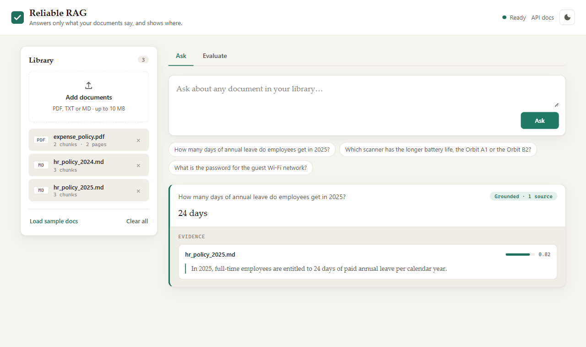
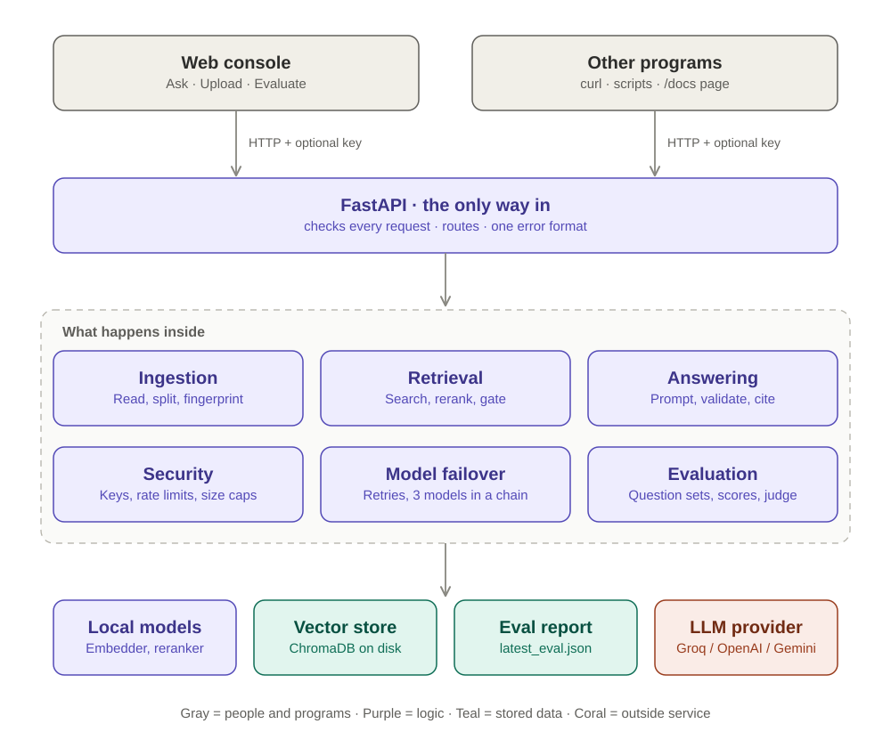
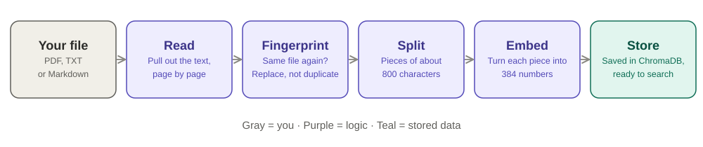
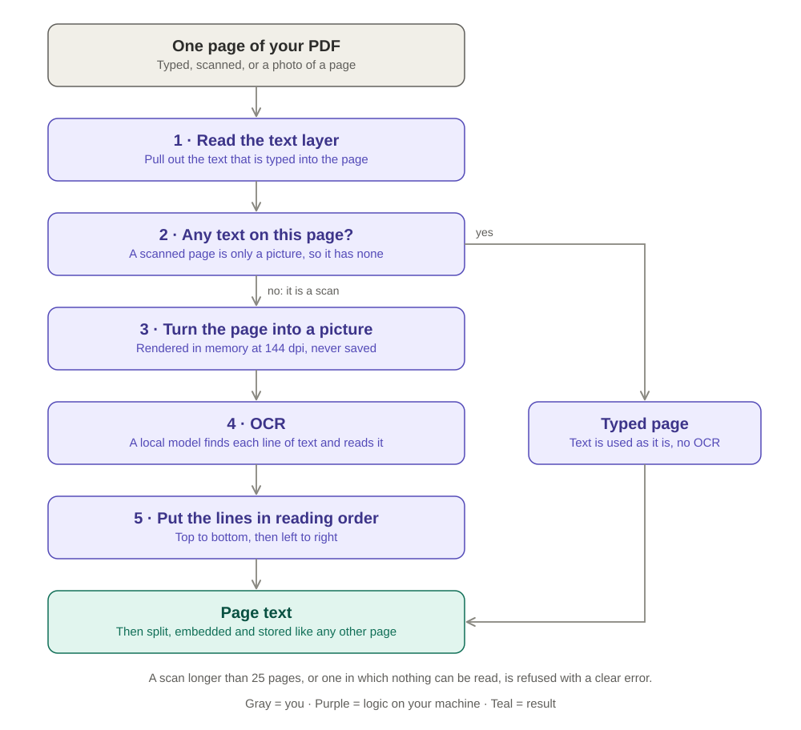
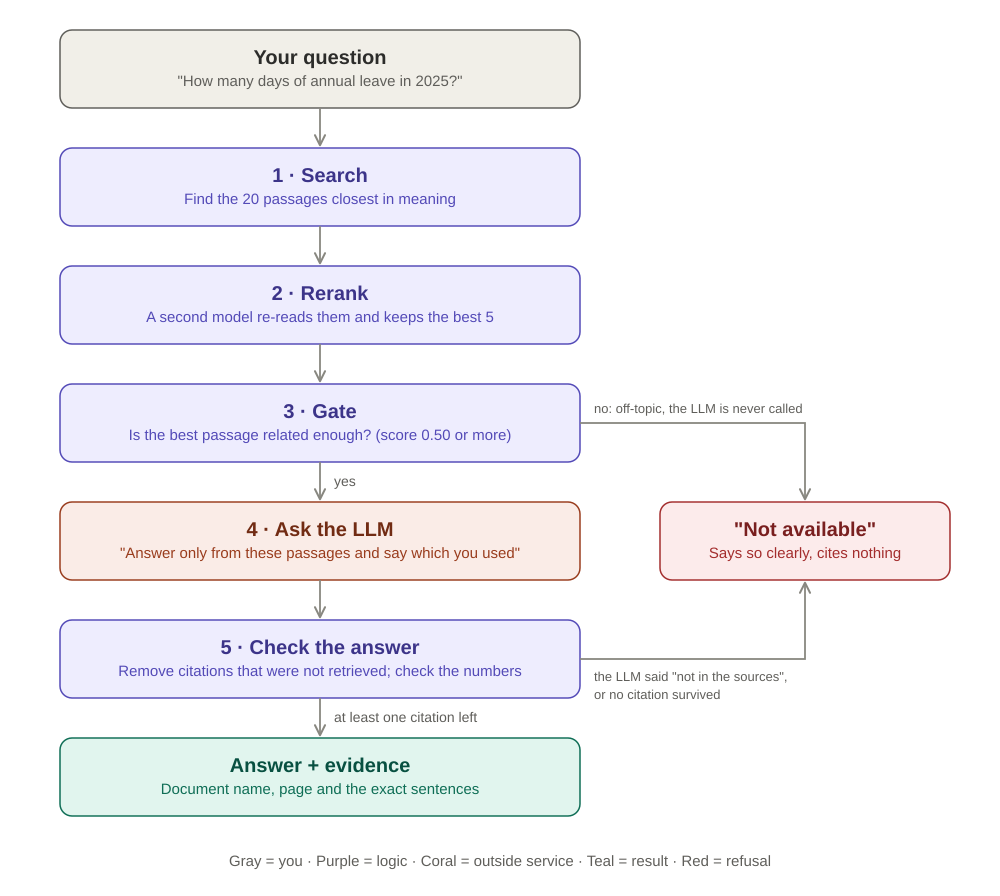
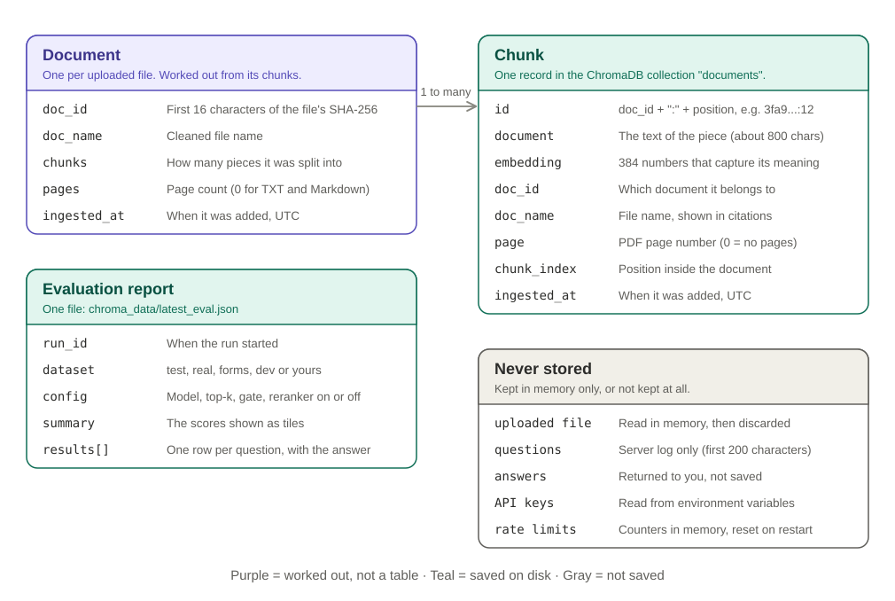

# Reliable RAG API

[](https://github.com/sanjith3057/reliable-rag-api/actions/workflows/ci.yml)

Upload your documents, ask a question in plain English, and get an answer that shows exactly which
document and sentence it came from. If your documents do not contain the answer, it tells you so
instead of making one up.



## What it does

- **Answers from your documents only.** It does not use what the AI model happens to know.
- **Shows its evidence.** Every answer comes with the document name, the page and the exact sentences.
- **Says "not available" when it should.** A question your documents cannot answer gets a clear refusal.
- **Can be measured.** It can test itself on your own documents and report how often it was right.

## Where to read next

| If you want to | Read |
| --- | --- |
| Use it: upload, ask, read an answer, fix a problem | [User guide](docs/USER_GUIDE.md) |
| Understand how it is built and why | [System design](docs/SYSTEM_DESIGN.md) |
| See the test results and how they were measured | [Evaluation and tests](docs/EVALUATION.md) |
| Call it from your own program | [API reference](docs/SYSTEM_DESIGN.md#api-reference) |

## Run it

You need one API key. A free one from [Groq](https://console.groq.com/keys) is the default.

- **Have an OpenAI or Gemini key instead?** In `.env` set `LLM_PROVIDER=openai` and
  `OPENAI_API_KEY=...`, or `LLM_PROVIDER=gemini` and `GEMINI_API_KEY=...`.
- **No key at all?** Set `LLM_PROVIDER=fake`. Answers are then just the best-matching sentence,
  which is enough to see uploading, search and citations work.

The free Groq plan is small (about 200,000 tokens a day per model). If you get "try again
later", the quota is spent: wait, or use a different key or provider.

### Option 1: Docker (easiest)

```bash
cp .env.example .env        # then open .env and paste your key after GROQ_API_KEY=
docker compose up --build
```

The first build takes several minutes: it installs PyTorch (CPU only) and downloads the two models
into the image, which ends up at about 3.8 GB. After that the container starts offline in seconds.

### Option 2: Python on your machine

Needs Python 3.12, 3.13 or 3.14.

```bash
python -m venv .venv
source .venv/bin/activate            # Windows: .venv\Scripts\activate
pip install -r requirements-dev.txt
cp .env.example .env                 # then open .env and paste your key after GROQ_API_KEY=
uvicorn app.main:app --factory
```

The first start downloads two small models (about 220 MB), so give it a minute.

### Then

Open **http://localhost:8000** in a browser.

1. Click **Load sample docs** (or **Add documents** to upload your own PDF, TXT or Markdown files;
   scanned PDFs work too).
2. Type a question and press **Ask**.
3. Read the answer and the evidence under it.
4. Open the **Evaluate** tab to measure how well it does.

The [user guide](docs/USER_GUIDE.md) walks through each step with examples.

## How it works

### The whole system



Everything goes through one server. The only thing outside your machine is the AI model that
writes the final sentence. Your documents are stored and searched locally.

### Adding a document



The file is split into small pieces, and each piece is turned into a list of numbers that captures
its meaning. Pieces with similar meaning get similar numbers, which is what makes search by meaning
possible. Uploading the same file twice replaces it; nothing is duplicated.

### Reading a scanned page



A scanned PDF is a set of pictures, so there is no text to pull out. For those pages the server
reads the picture with OCR (optical character recognition), a small model that runs on your
machine. Typed pages skip this step, so ordinary PDFs are as fast as before.

### Asking a question



1. **Search.** Find the 20 pieces whose meaning is closest to the question.
2. **Rerank.** A second, more careful model re-reads those 20 and keeps the best 5.
   The pieces that sit next to them in the document are added too (up to 8 in all), so a list or
   section that was split across pieces reaches the AI model whole.
3. **Gate.** If even the best piece is unrelated to the question, stop here and say "not available".
   The AI model is never called, so it cannot guess.
4. **Ask the AI model.** It is given only those pieces and told to answer from them and to name the
   ones it used.
   A question about one fact gets a one-line answer. A question that asks for a list, an explanation
   or a summary gets several sentences or a short list.
5. **Check the answer.** Any source the model names that was not one of the pieces is removed. If no
   source is left, the answer is thrown away and replaced by "not available". Numbers in the answer
   are checked against the cited text.

Steps 3 and 5 are ordinary code, not AI. That is why an invented source can never reach you,
whichever model is used.

### What is stored



There is no SQL database. Everything searchable lives in one ChromaDB collection on disk, in the
`chroma_data` folder. Delete that folder and the library is empty again.

## Does it work?

Measured with the real AI model, not a simulation, on 13 Oct 2026.

| Question set | What it tests | Result |
| --- | --- | --- |
| 20 questions on 8 made-up company documents | Answers must come from the documents, because no AI model knows these facts | 20 / 20 |
| 18 questions on the 88-page GDPR regulation | Finding the right passage in a long, dense, real document | 18 / 18 |
| 18 questions on a filled-in form and a handwritten scan | Documents that are not prose, and text read with OCR | 17 / 18 |
| 21 questions on a 48-page project report, in five difficulty levels | From single facts up to questions that must be refused | 21 / 21 |
| 10 questions written automatically from a document it had never seen | Does it work on someone else's file? | 10 / 10 |

The one miss is the date on the handwritten page: it says 2024 and the OCR read 2624. The first
three sets were run before the project report was added to the bundled documents and have not
been re-run with it; the report set ran on the weakest of the three models. These sets are small and I wrote most of them, and earlier runs scored lower:
one question on the GDPR set has passed in some runs and failed in others.

The same questions grouped by difficulty level and by document format (PDF, Markdown, plain text,
form, scan) are in the [question bank](eval/QUESTION_BANK.md).
The full numbers, the runs that went badly and what was changed are in
[Evaluation and tests](docs/EVALUATION.md).

There are also 194 automated tests. They run in about half a minute with no API key and no internet.

```bash
pytest
```

## Safety

- **Optional passwords.** Set `API_KEY` to require a key for every request. A second, read-only key
  can ask questions but cannot upload or delete.
- **Rate limits.** Each client gets 30 questions, 20 uploads and 3 evaluations a minute.
- **Size limits.** 10 MB and 500 pages per file, 1,000 characters per question.
- **Hostile documents.** A document that says "ignore your instructions" is treated as text to
  quote, not as an order. One such document is included in the samples and in the tests.
- **Secrets.** API keys are read from the `.env` file, which is never committed, and never appear
  in answers or logs.

Details are in [System design: security](docs/SYSTEM_DESIGN.md#security).

## Words used here

| Word | Meaning |
| --- | --- |
| RAG | Retrieval-augmented generation: look up the relevant text first, then let an AI model write the answer from it |
| LLM | Large language model, the AI that writes the final answer (here: a model hosted by Groq) |
| Chunk | One small piece of a document, about 800 characters |
| Embedding | A list of numbers that represents the meaning of a chunk or a question |
| Vector store | The database that holds the embeddings and finds the closest ones (here: ChromaDB) |
| Reranker | A second model that re-reads the search results and puts the best ones first |
| Grounded | Every claim in the answer is backed by a passage from your documents |
| Abstain | To answer "not available" instead of guessing |

## What is in this repository

```
app/                 the server
  api/               the web addresses (endpoints)
  ingestion/         reading files and splitting them
  retrieval/         search, reranking, the vector store
  generation/        the AI model, the prompt, the answer checker
  evaluation/        question sets, scoring, the judge
  static/            the web console
  security.py        keys, rate limits, size limits
  pipeline.py        the steps of "add a document" and "ask a question"
  config.py          every setting
docs/                user guide, system design, evaluation, diagrams
eval/                question sets, recorded results and the question bank by level
sample_docs/         8 made-up company documents to try it with
real_docs/           the 88-page GDPR regulation, a 48-page project report, a form and a handwritten scan
tests/               194 automated tests and their recorded results
Dockerfile, docker-compose.yml
```

## Assessment requirements

| Requirement in the brief | Where it is met |
| --- | --- |
| Ingest PDF, TXT, Markdown and split into chunks | `POST /ingest`, `app/ingestion/` (scanned PDF pages are read with OCR) |
| Semantic search with embeddings and a vector store | `app/retrieval/` (`bge-small-en-v1.5`, ChromaDB) |
| LLM answers grounded in retrieved content | `app/pipeline.py`, `app/generation/prompt.py` |
| Evidence: document names and excerpts | `sources` on every answer: document, page, excerpt, score |
| Say clearly when the information is unavailable | The gate and the answer checker (`app/generation/validator.py`) |
| API in FastAPI | `app/api/routes.py`, interactive docs at `/docs` |
| At least 10 evaluation questions of three kinds | 98 questions in `eval/`: answerable, unanswerable, multi-evidence, distractor |
| Clean, modular Python | One package per stage; models sit behind interfaces |
| Environment variables for keys and config | `app/config.py`, `.env.example` |
| Tests for retrieval, API behaviour, failure cases | `tests/` (194 tests), results in [`tests/RESULTS.md`](tests/RESULTS.md) |
| Docker support and setup documentation | `Dockerfile`, `docker-compose.yml`, "Run it" above |
| Existing LLM API, no training from scratch | Groq, OpenAI or Gemini; the embedding model is pretrained |
| Sample documents and evaluation questions | `sample_docs/`, `real_docs/`, `eval/questions_*.json` |
| Test results | [`tests/RESULTS.md`](tests/RESULTS.md), [`eval/results.md`](eval/results.md), [`eval/results_real.md`](eval/results_real.md) |
| Discussion of limitations | Below, and in full in [System design](docs/SYSTEM_DESIGN.md#limitations) |

## Limitations

- **Handwriting is read badly by default.** Scanned pages are read with a local OCR model. Clean
  printed scans read well. Handwriting and skewed photos do not: on the bundled handwritten page it
  read "Data Engineering" as "Dota Engineguing" and the year 2024 as 2624, and the answer repeats
  the misread text. Setting `OCR_VISION_FALLBACK=true` sends such pages to an AI model that reads
  images. In one test by hand that model read every line of the page correctly, and also wrote a
  score for a scribble nobody could read. It is off by default because the page image leaves your
  machine.
- **A question that repeats a document's title can miss.** Asking "Which GPU was used for the
  offensive language detection project?" brought back the title page and the certificate, which
  repeat those words, and not the hardware page. "Which GPU was used to fine-tune Distil-BERT?"
  found it.
- **A scan is limited to 25 pages** and takes a few seconds a page.
- **English only.**
- **Summaries work, but a summary of a long document can miss details.** "Summarise this document"
  reads about 8 passages spread evenly across the library, not every page.
- **A table can be cut in half** when a document is split into pieces.
- **Forms are harder than prose.** A PDF form loses its layout when read, so a value can end up far
  from its label. On a test form, the weakest fallback model gave the wrong phone number.
- **It can add a conclusion your document does not state.** Asked "Is amoxicillin safe for her?"
  about a form that records a penicillin allergy, it answered "not safe". The allergy is in the
  form; the link to amoxicillin is the AI model's own knowledge.
- **The free Groq plan runs out.** About 200,000 tokens a day per model. Three models are tried in
  turn, then you get a clear "try again later" message.
- **Everyone with a key sees the same library.** There are no separate user accounts.
- **It is not a benchmark.** The question sets are small and I wrote most of them.

The full list, with what each fix would take, is in
[System design: limitations](docs/SYSTEM_DESIGN.md#limitations).

## Future upgrades

Not built yet, in the order I would do them:

- **Follow-up questions.** Each question is answered on its own today, so "and for contractors?"
  does not know what came before. The plan is to rewrite a follow-up into a full question from the
  previous turn and then search as usual, so every answer is still backed by a document. A chat
  memory library (mem0) was considered and left out for now: remembered chat would be a second
  source of facts that has no citation.
- **Summaries that read every page**, by summarising a long document section by section.
- **Smarter splitting** that keeps a table whole and carries the section heading into each piece.
- **Trust in the second reading of handwriting.** The optional vision fallback has been tried on
  one page. It needs a question set of its own, and a check that flags words the two readings
  disagree on.
- **Search that is not pulled towards title pages** when a question names the document.
- **Separate libraries per user**, with accounts in place of shared keys.
- **A larger question set written by someone else**, scored by an independent judge model.

## License

See [LICENSE](LICENSE).
